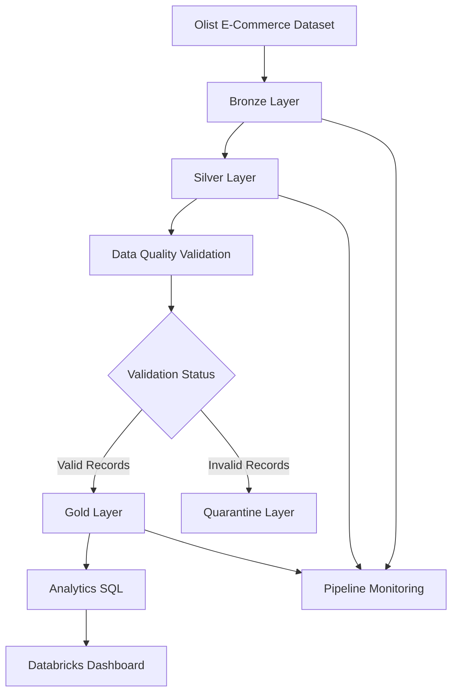

# Olist E-Commerce Data Engineering Platform

An end-to-end e-commerce data engineering project built using Databricks, PySpark, Delta Lake, and SQL. This project transforms raw e-commerce data into clean, structured, analytics-ready datasets and business insights.

## Project Overview

The goal of this project is to build a data engineering pipeline that processes e-commerce data through multiple layers, performs data quality validation, monitors pipeline execution, and provides business insights through analytical tables and a dashboard.

The platform follows the **Medallion Architecture** approach:

- **Bronze:** Raw data ingestion
- **Silver:** Data cleaning and transformation
- **Gold:** Business-ready analytics

---


## Architecture




---

## Tech Stack

| Technology | Purpose |
|---|---|
| Databricks | Data engineering platform |
| PySpark | Data processing and transformation |
| Apache Spark | Distributed data processing engine |
| Delta Lake | Reliable data storage |
| SQL | Data analysis and business queries |
| Python | Pipeline implementation |
| Medallion Architecture | Data organization |
| Databricks Jobs | Pipeline execution |
| Databricks Dashboards | Data visualization |

---

## Data Pipeline

### 1. Bronze Layer — Data Ingestion

Raw e-commerce data is ingested into the Bronze layer.

**Responsibilities:**
- Raw data ingestion
- Initial data storage
- Source data preservation
- Preparing data for downstream processing

### 2. Silver Layer — Data Cleaning & Transformation

The Silver layer transforms raw data into cleaner and more reliable datasets.

**Operations include:**
- Data cleaning
- Null value handling
- Record validation
- Duplicate detection
- Data transformation
- Reconciliation between Bronze and Silver
- Invalid record handling

### 3. Gold Layer — Business Analytics

The Gold layer contains analytics-ready datasets designed for reporting and business analysis.

**Analytics include:**
- Monthly sales analysis
- Monthly revenue analysis
- Order status analysis
- Seller performance
- Top-selling products
- Business KPIs

---

## Data Quality & Validation

Data quality checks are implemented to improve reliability and consistency.

### Implemented checks

- Null value validation
- Duplicate record validation
- Data quality monitoring
- Bronze-to-Silver reconciliation
- Invalid record identification
- Quarantine handling
- Pipeline health monitoring

### Reconciliation

The pipeline validates processed records against source records to identify discrepancies.

Example reconciliation:

| Dataset | Records |
|---|---:|
| Bronze Order Items | 112,650 |
| Silver Order Items | 112,650 |
| Quarantined Order Items | 0 |
| Unreconciled Records | 0 |

---

## Incremental Data Processing

An incremental data loading framework has been initiated using a watermark-based approach.

### Implemented components

- Watermark table creation
- Initial watermark configuration
- Latest processed timestamp tracking
- Detection of records newer than the watermark

The current implementation establishes the incremental processing foundation. Full end-to-end incremental upsert processing is a future enhancement.

---

## Pipeline Monitoring

Pipeline execution is monitored using persistent logging and health summary tables.

### Monitoring Features

- Pipeline execution logs
- Run status tracking
- Execution duration monitoring
- Failure tracking
- Pipeline health checks
- Data quality status

### Pipeline Health Summary

| Metric | Status |
|---|---|
| Total Health Checks | 5 |
| Passed Checks | 5 |
| Failed Checks | 0 |
| Overall Status | HEALTHY |

Pipeline execution logs are stored persistently for monitoring and troubleshooting.

---

## Job Orchestration

A Databricks Job has been configured to execute the main ETL pipeline.

### Configuration

- Main ETL notebook execution
- Serverless compute
- Retry configuration
- Failure notification configuration
- Job execution monitoring

---

## Dashboard

An interactive Databricks dashboard has been developed to visualize business performance.

### Dashboard Metrics

- Total Revenue
- Total Orders
- Total Items Sold
- Monthly Revenue Trend
- Monthly Orders
- Top 10 Best-Selling Products
- Order Status Distribution

### Dashboard Features

- Interactive monthly filter
- KPI cards
- Revenue trend analysis
- Product performance analysis
- Order status distribution

---

## Key Business Metrics

| Metric | Value |
|---|---:|
| Total Revenue | 15,842,174.32 |
| Total Orders | 99,433 |
| Total Items Sold | 112,650 |

These metrics provide an overview of order volume, revenue generation, and product sales performance.

---

## Project Structure

```text
olist-ecommerce-data-engineering/
│
├── README.md
│
├── notebooks/
│   ├── 01_Business_Requirements_And_Data_Exploration.ipynb
│   ├── 02_ETL_Architecture_And_Workflow.ipynb
│   ├── 03_ETL_Pipeline_Implementation.ipynb
│   └── 04_Incremental_Data_Load.ipynb
│
├── sql/
│
├── docs/
│
└── dashboard/
```

---

## Learning Objectives

Through this project, I worked on:

- Building an ETL pipeline
- Working with PySpark and Spark DataFrames
- Understanding the Medallion Architecture
- Implementing Bronze, Silver, and Gold layers
- Data cleaning and transformation
- Data quality validation
- Reconciliation and duplicate detection
- Quarantine handling
- Delta table management
- Incremental processing concepts
- Pipeline logging and monitoring
- Databricks Job configuration
- SQL-based analytics
- Dashboard development

---

## Future Improvements

- Complete end-to-end incremental loading with MERGE/upsert
- Implement multi-task workflow orchestration with dependencies
- Add automated pipeline scheduling and verification
- Improve failure recovery and alerting
- Expand data quality rules
- Add more analytical datasets
- Implement automated testing
- Optimize Spark processing and performance
- Improve dashboard design and analytics
- Integrate CI/CD and Git-based deployment workflows

---

## Author

**Abiribah Ullash**

Aspiring Data Engineer | PySpark | SQL | Databricks | Delta Lake

This project is part of my journey toward becoming a professional Data Engineer and building production-oriented data engineering skills.
